# Nimbles

Skill-only games for [Nimiq Pay](https://nimiq.dev/mini-apps). Eighteen matches, four modes, real rivals. No dice, no random draws: the better player wins. Win and Save pots take a 2% fee (capped at 1 NIM) that funds the savers' interest pool.

**Live:** [nimbles-mainnet.fly.dev](https://nimbles-mainnet.fly.dev) (mainnet, real NIM) · [nimbles-nimiq.fly.dev](https://nimbles-nimiq.fly.dev) (testnet, play money)

Built for the [Nimiq Mini Apps Competition](https://www.nimiq.com/miniapps) (MIT).

## Screenshots

| Hub | Modes | Splat Royale | Savings jar | Nimo |
| --- | --- | --- | --- | --- |
| 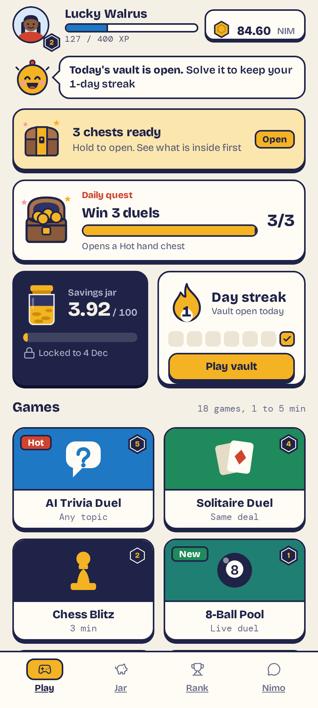 | 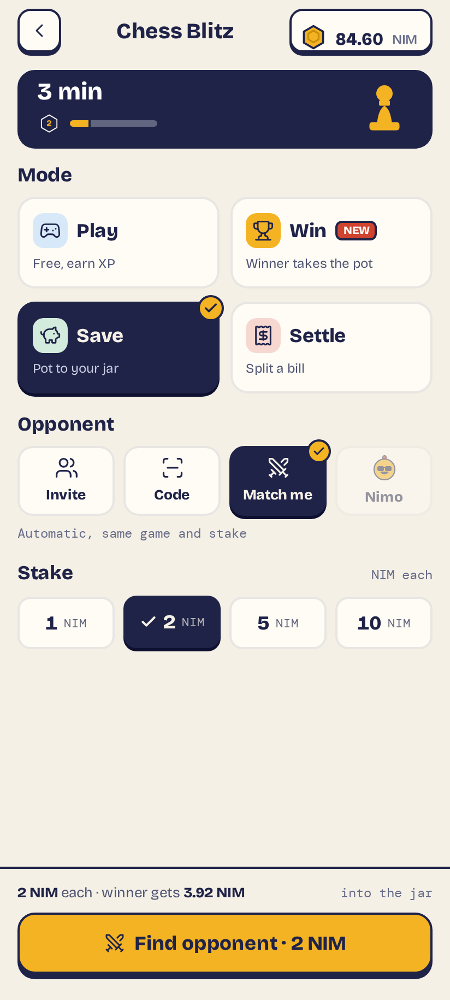 | 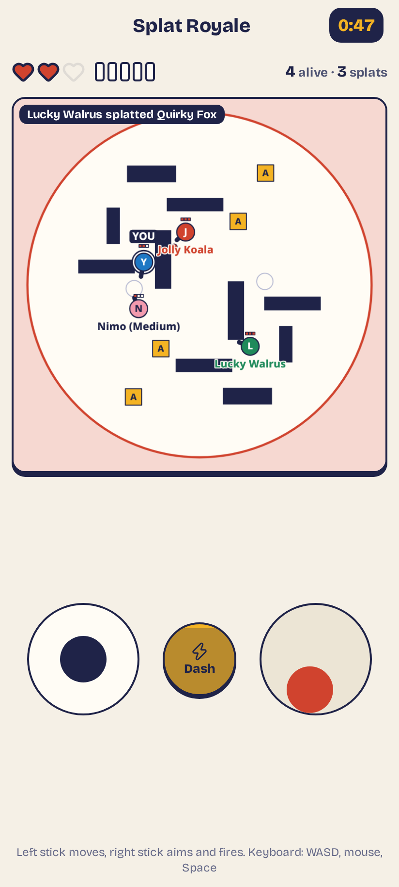 | 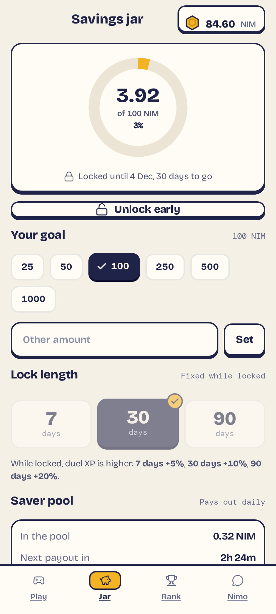 | 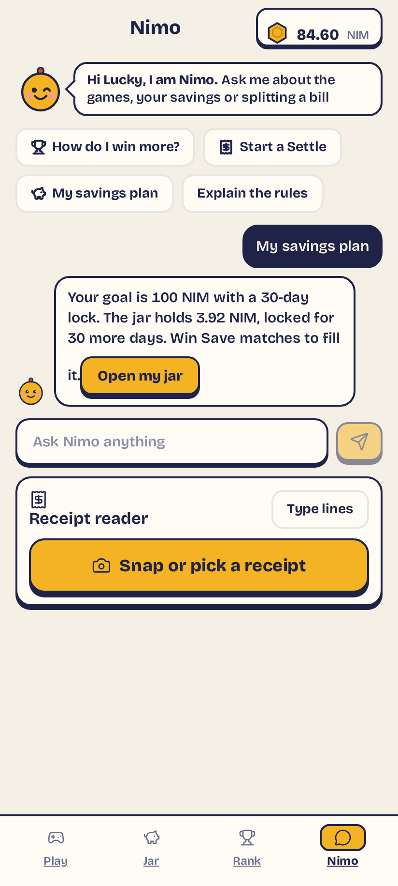 |

### All 18 games

| AI Trivia Duel | Solitaire Duel | Chess Blitz |
| --- | --- | --- |
| 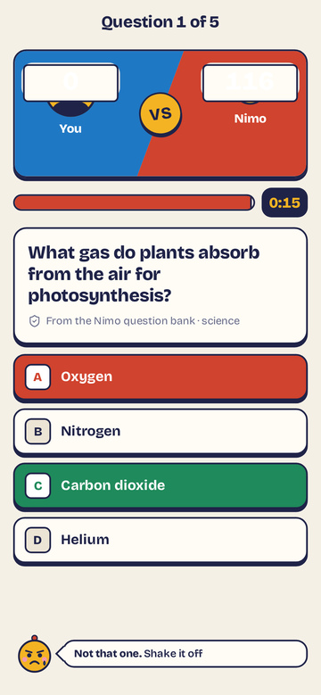 | 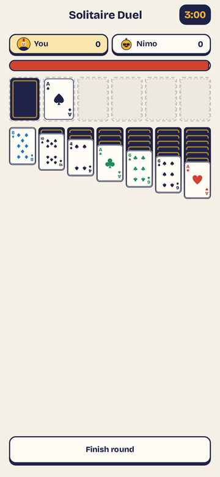 | 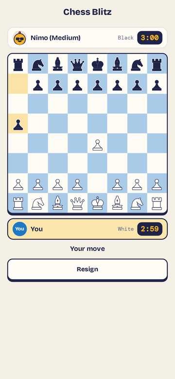 |

| 8-Ball Pool | Sudoku | Bubble Shooter |
| --- | --- | --- |
| 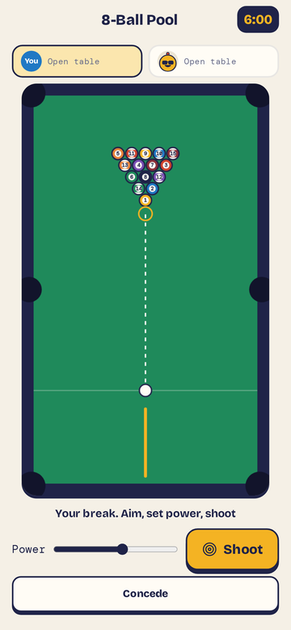 | 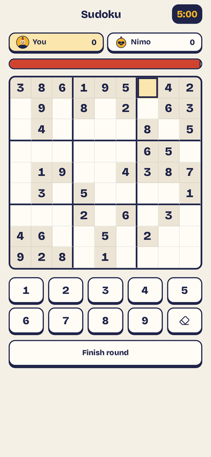 | 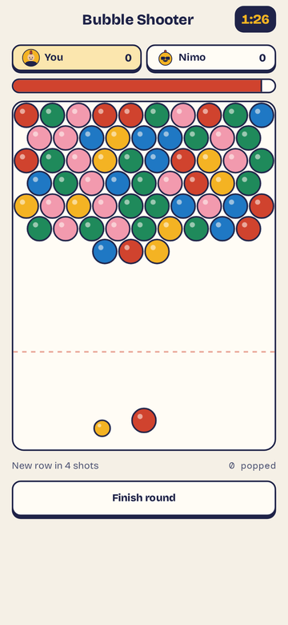 |

| Word Rush | Last Bite | Darts |
| --- | --- | --- |
| 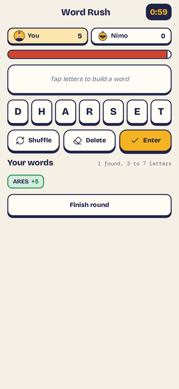 | 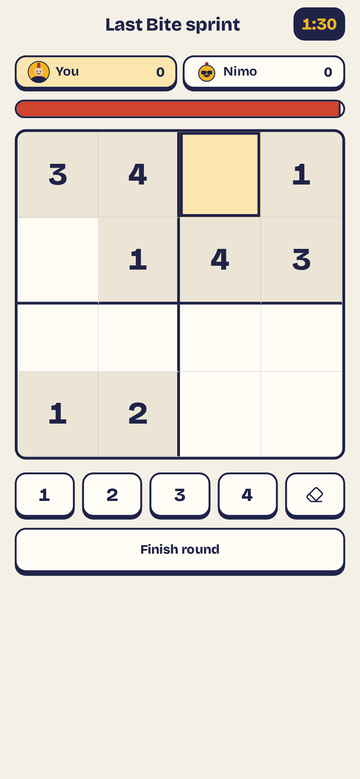 | 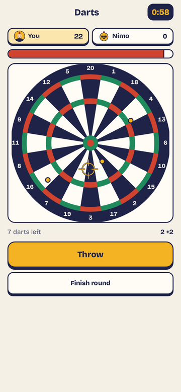 |

| Block Puzzle | Speed Math | Spider Solitaire |
| --- | --- | --- |
| 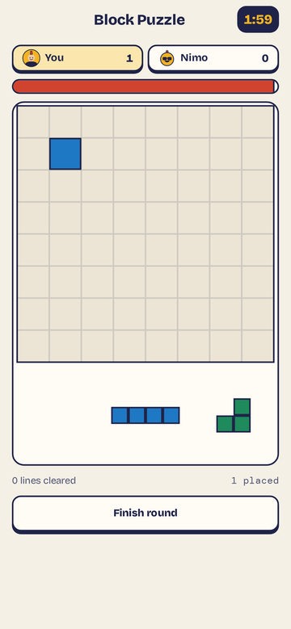 | 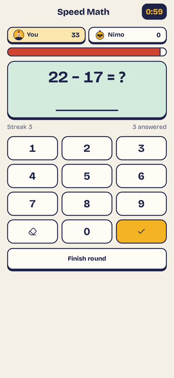 | 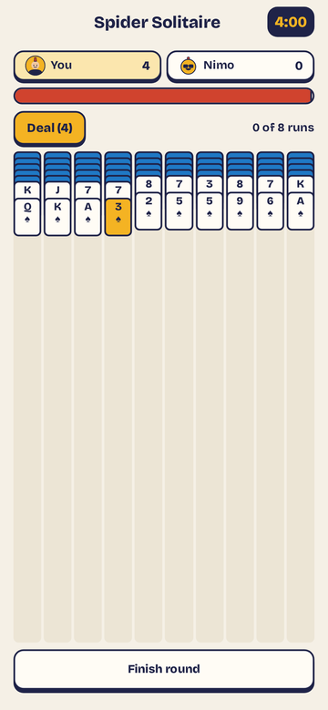 |

| Domino Chain | 21 Blitz | Bowling |
| --- | --- | --- |
| 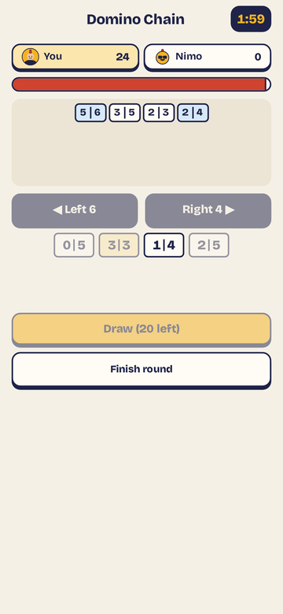 | 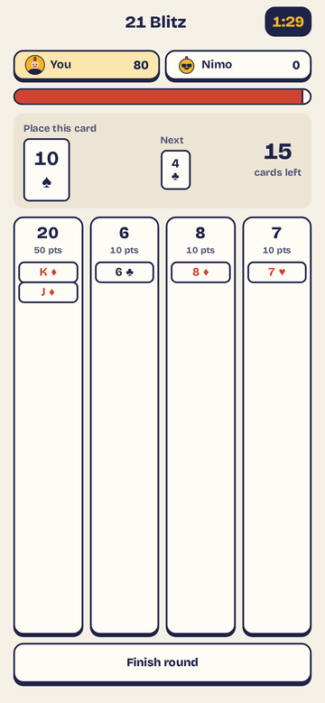 | 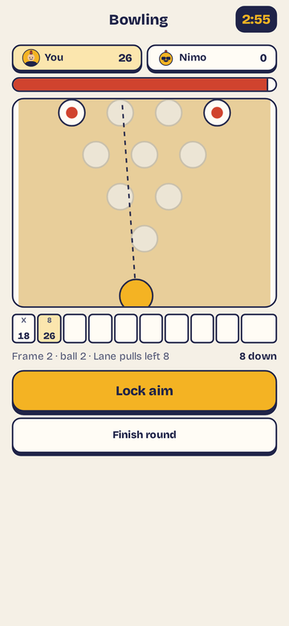 |

| Carrom | Ghost Race | Splat Royale |
| --- | --- | --- |
| 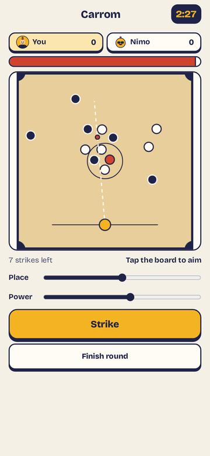 | 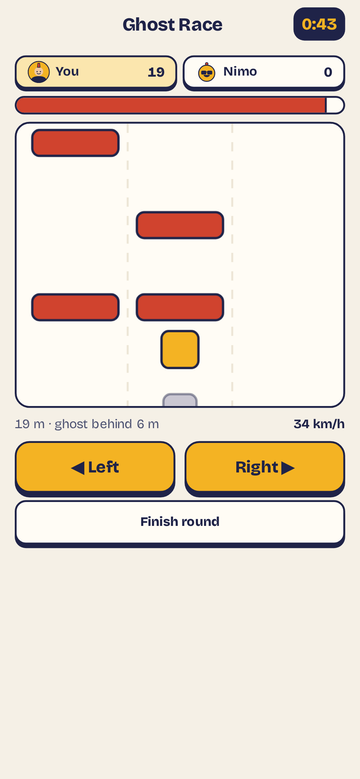 | 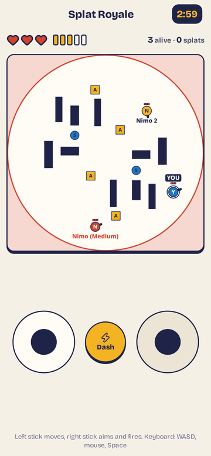 |

## Modes

- **Play** — free. Practice against Nimo (Easy / Medium / Hard) or a friend. Earns XP and rank.
- **Win** — both stake NIM. The winner takes the pot (minus the 2% saver fee), paid to their wallet. Splat Royale can pay winner-takes-all or 60 / 30 / 10 to the top three.
- **Save** — same stake as Win, but the winner's pot goes into their locked savings jar.
- **Settle** — invite-only (share a code, or join one). Agree the bill, who is paid, and the split before anyone locks NIM: loser pays all, 70 / 30, or a custom split. A draw splits evenly. Splat Royale Settle splits by finishing place (last pays most). Each player locks only their own largest possible share.

Nimo is free-play only. Staked modes need a real rival (invite, join by code, or Match me).

## Games

| Game | How it is played | Result is decided by |
| --- | --- | --- |
| AI Trivia Duel | Same 5 questions, speed and accuracy | Server (answers stay on it until the round ends) |
| Solitaire Duel | Same deal from a shared seed | Server replay of your move log |
| Chess Blitz | 3:00 per side, live | Server-run board and clocks |
| 8-Ball Pool | Live turns, 60 s shot clock | Server-run physics |
| Sudoku | Same 9×9 grid, first to solve | Server checks the grid |
| Bubble Shooter | Same board and bubble queue | Server replay of your shot log |
| Word Rush | Same letters, find words | Server recomputes the score |
| Last Bite | Quick 4×4 sudoku sprint | Server checks the solved grid |
| Darts | 10 darts, tap to stop a moving reticle | Server replay of your throw times |
| Block Puzzle | Same pieces, clear lines | Server replay of your placements |
| Speed Math | 60 seconds of sums, same list | Server recomputes from your answers |
| Spider Solitaire | One suit, eight runs, same deal | Server replay of your move log |
| Domino Chain | Same tiles, build the longest chain | Server replay of your plays and draws |
| 21 Blitz | 20 cards onto four stacks, aim for 21 | Server replay of where each card went |
| Bowling | Ten frames, two timed taps per ball | Server replay of your tap times |
| Carrom | Eight strikes on a shared board | Server replay of your strikes |
| Ghost Race | 45 second three-lane dash vs a fixed-pace ghost | Server replay of your lane changes |
| Splat Royale | 2 to 6 players, twin-stick arena, last one standing | Server simulation at 30 ticks/s |

Splat Royale phones only send stick and dash input. The server runs the whole match with no random numbers, so the same inputs always give the same result. If a staked match cannot finish, every stake is refunded. Practice fills empty seats with Nimos.

## Savings jar, chests and XP

- Lock NIM for **7, 30 or 90 days**. Unlocking early costs up to **10%** of the jar at the start of the lock, falling in a straight line to zero at the end. The fee stays in the savers' pool.
- Win and Save pots put **2%** of the pot (capped at 1 NIM) into that pool. Each day the pool pays a share to locked savers, weighted by balance × lock days × boost.
- Level and chest boosts raise a saver's share of the pool (up to +40% combined). A locked jar also adds match XP (+5% / +10% / +20% for 7 / 30 / 90 days).
- **Chests** are fixed and earned (daily win, hot hand, streak 3 / 7 / 30, level-up). You can read the contents before you open one. They never hold NIM and never roll dice.

## Nimo

Nimo is the in-app host: free practice opponent, daily vault reminder, and chat guide. Ask about modes, the jar, or a receipt and it will point you to the right screen.

## Fairness and money

- **Same seed.** The server publishes `sha256(seed)` when a match is made and reveals the seed at the start. Both players get the same deal and can check it.
- **Replay or live relay.** Turn-based games upload a move log; the server recomputes the score. Chess and Pool vs a human are fully server-authoritative. Splat is server-simulated.
- **Signed sign-in.** The wallet signs a one-time challenge (single use, 2 minute expiry). The address comes from the signature. Session tokens are short-lived and bound to that address. Mainnet never accepts an unsigned session; testnet and the mock still allow an unverified preview.
- **Escrow.** Players pay a server wallet with memo `nb:<matchId>`. Deposits need confirmations (default 2). Winners are paid out automatically, or refunded on a draw / cancel. The escrow is custodial in this version; a production build should move to HTLC or contract-style escrow. Stakes are capped (25 NIM by default on mainnet).

## Nimiq integration

- `@nimiq/mini-app-sdk` for `init`, accounts and `sendBasicTransactionWithData` (1 NIM = 100,000 luna).
- `server/chain.ts` talks to Nimiq JSON-RPC (`rpc.nimiqwatch.com` on mainnet, `rpc.testnet.nimiqwatch.com` on testnet), verifies deposits, and signs payouts offline with `@nimiq/core`.
- One flag switches networks (`CHAIN=nimiq NETWORK=testnet|mainnet`). Mainnet also needs `ALLOW_MAINNET=yes`, a pre-existing escrow key, and `EXPECTED_ESCROW_ADDRESS`. It never auto-generates a key.

## Run it

```bash
npm install
cp .env.example .env     # optional; defaults to the in-memory mock chain
npm run build
npm start                # http://localhost:8787
```

Dev with hot reload: `npm run dev` (Vite on 5173, API proxied). Outside Nimiq Pay the app opens in preview mode (free play, no wallet).

### Try it in Nimiq Pay

1. Open Nimiq Pay → Mini Apps → Custom URL.
2. Enter https://nimbles-mainnet.fly.dev (real NIM) or https://nimbles-nimiq.fly.dev (testnet), or `http://<LAN-IP>:5173` from `npm run dev`.

### Tests

```bash
npm test                 # unit tests
npm run build && npm run e2e   # headless phone browser vs the mock chain
```

## Licence

[MIT](LICENSE) © 2026 Chris Gold.
